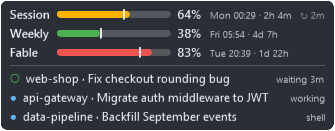

# Claude Usage Indicator

A small always-on-top Windows overlay that shows your Claude usage relative to limits, plus the status of all your open sessions. Can play a chime once a session becomes idle. I'm sure there's a million of these already.



## Features

- Session, weekly and Fable limits as colour-coded bars, including reset time
- A tick on each bar shows the current point in the window, so you know whether to adjust behaviour.
- Lists current sessions and their statuses, optional chime when session becomes idle.
- Shrinks to a small dial when no sessions are active
- Adjustable opacity, preserves position, doesn't draw over anything fullscreen
- Optional run at startup

## Data source

Reuses current Claude login credentials to fetch usage.
Session status comes from the files Claude Code keeps for each running session.
No data leaves the process.

## Build

Windows only, needs the .NET 10 SDK:

```powershell
cd src\ClaudeUsageIndicator
dotnet publish -c Release -o ..\..\publish
..\..\publish\ClaudeUsageIndicator.exe
```

Settings live in `%APPDATA%\ClaudeUsageIndicator\config.json` (also reachable from the tray menu).

## License

MIT
